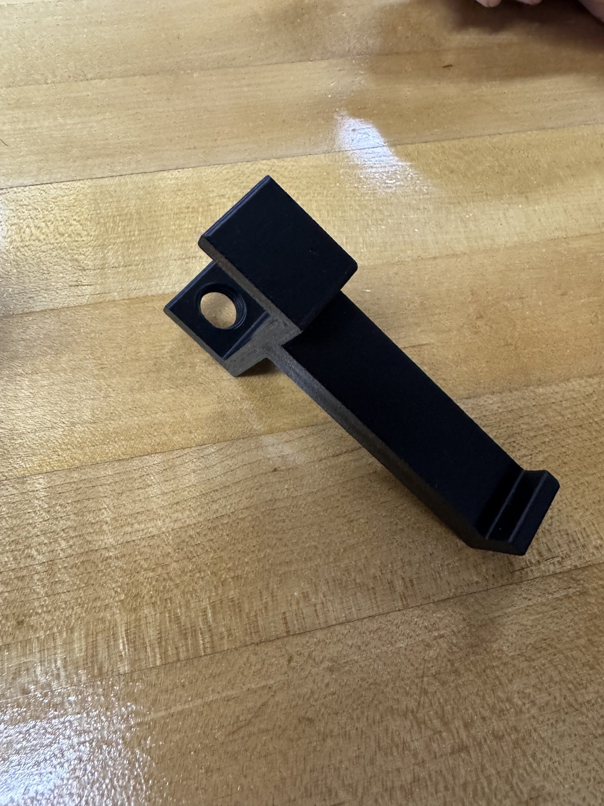
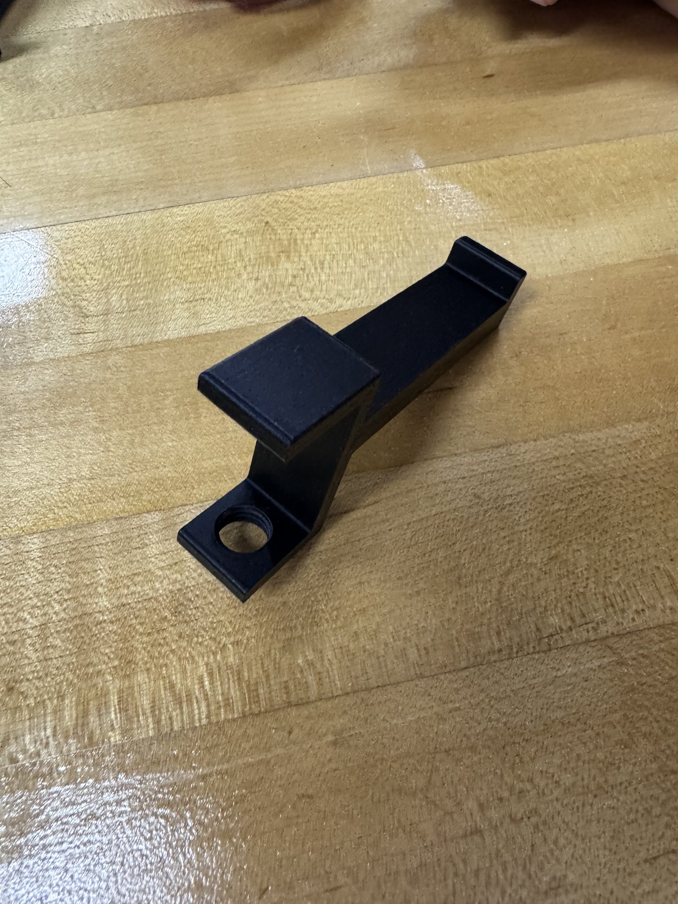
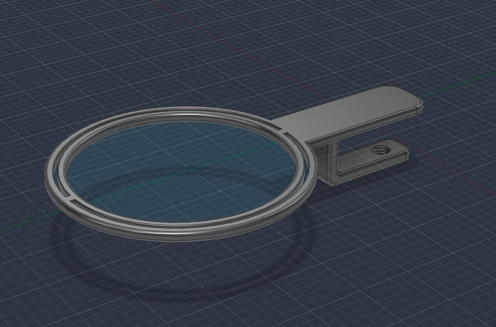
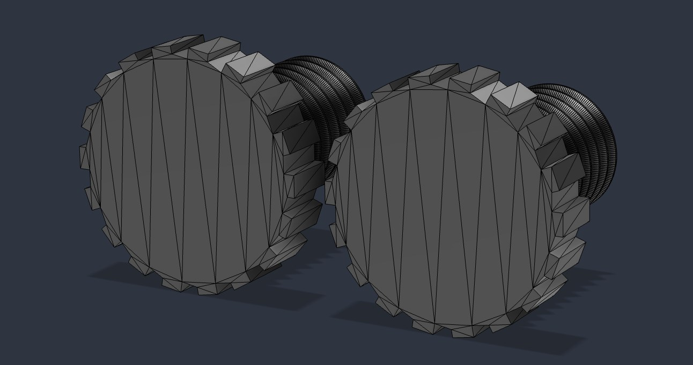
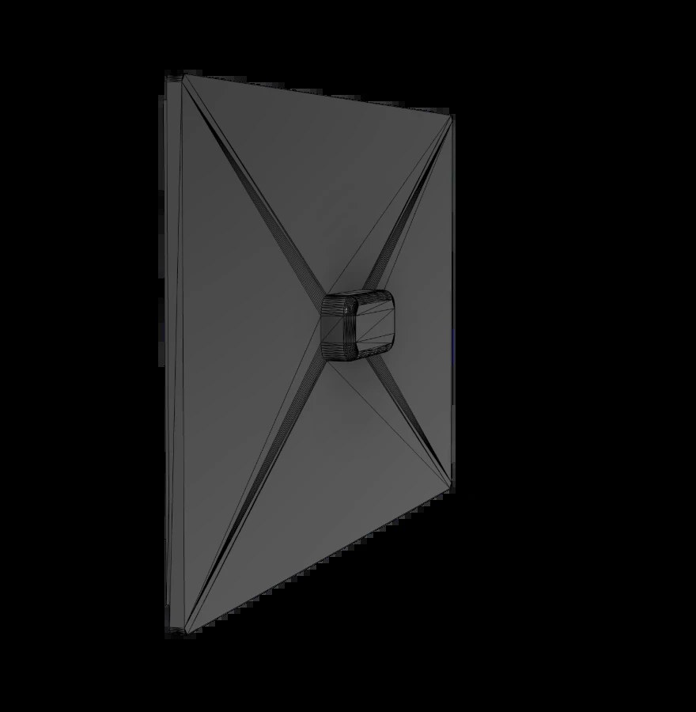

# Side Project: Trash Holder

**Date added:** 2026-09-25
**Last updated:** 2026-10-14
**Status:** Version 2 in progress. One part printed, tub modeled, not assembled or tested yet.

## The problem
- My nose runs and I sneeze all the time, and it has been like that my whole life
- Used tissues end up in a pile next to me on the desk
- I want somewhere right at my desk to put them

This grew out of the "tissue holder under table" idea in `sources/brainstorm-2026-08-25.md`.

## Why a clamp
- Tape: easy to move, but it gets weak over time
- Screws into the desk: too permanent
- Clamp: holds strong, and can still be moved to another desk
- It uses a microphone-style twist clamp, so no measuring is needed: you just screw it tight onto the desk edge

## Version 1 (dropped)

- One clamp with a ring on an arm
- The plastic trash bag goes through the ring, which has a hole in the middle
- The inner ring has small supports so it stays connected to the outer ring
- A screw in the clamp tightens it onto the desk and holds it there
- Got about halfway in Fusion 360, then switched to Version 2

## Version 2 (current)
- Two clamps, one on each side, with a tub sitting in the middle
- Why the change: it is modular. The clamps can adjust to different tables without redesigning the whole thing
- The tub replaces the trash bag

## Making

- The cover: a flat square lid with ridges in an X from the corners to a small knob in the middle
- The 2 screws: each has a bumpy (knurled) head so it is easy to twist by hand, and a thread that goes into the clamp to tighten it onto the desk
- Modeled in Fusion 360, about 1 day per part
- Side project: I work on it when I am a bit burnt out on the chess board
- Printed so far: 1 part (in the photos, black filament). It came out fine
- Tub: modeled, printing next
- Still to print: the second clamp and 2 screws

## Testing
- Not tested yet: no screw yet, so the printed part has not been fitted to the clamp
- No user testing yet

## Next steps
1. Print the tub
2. Print the second clamp and 2 screws
3. Assemble and fit it to my desk
4. Use it for a while, write down what works and what doesn't
5. Fix anything that comes up (iteration is fast since it is still being made)
